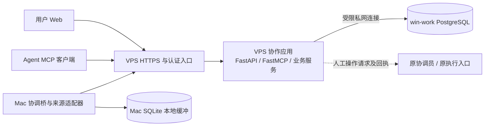

# ADR-001：将 Task Mailbox 扩展为协作监控与数据共享平台

## 状态与范围

- 状态：**Accepted**，公子于 2026-11-14 明确采纳并授权并行实施、部署及凡人原任务验证；实施结果另记。
- 日期：2026-11-14（Asia/Shanghai）。
- 维护仓：`CF-FE/task-mailbox-mcp`。
- 当前代码基线：`496589fa9f6a60a64d9066953f2962e8a997d8e8`。
- 本文是本次重构唯一架构记录，后续意见直接修订本文。

### 2026-11-14 部署与 Web 认证修订

公子随后明确提出“web服务，启动在mac-work 本机，不需要授权登录”，指出 VPS 太慢，并指示“关闭 VPS上的web服务，释放资源”。据此替换本文初版的 **Web 与其查询 API 统一留在 VPS、Web 使用 GitHub 登录** 两项选择，其余统一 PostgreSQL、原信箱与协调桥、证据及验收边界继续有效。

当前部署为 `Mac 浏览器 → Mac 回环只读 Web/API → 独立局域网 SSH/TLS → Win PostgreSQL`。本机只监听 `127.0.0.1:8767`，由显式项目名单和独立数据库 SELECT 账号限制可见范围；本机 session 明示 `mode=local`，不伪造 GitHub 身份。来源清单仍用于判断数据缺失及陈旧。原浏览器界面、查询服务与数据模型复用，没有第二个业务库。

VPS 继续提供原受 OAuth 保护的 MCP 以及带来源令牌的观测上报／回执，关闭公网页面、浏览器会话、查询和 SSE 路由。本机入口没有 MCP、写入、OAuth 或人工指派能力。今后的人工操作与跨机开放需单独明确边界；本次不开放 LAN HTTP 端口。停用本机组件只停止其独立 Web 与转发，不撤销原任务、数据库记录或其他连接。

保留 VPS Web 能复用原认证，但已观察到公网链路和跨地域数据库访问的超时；本机方案减少查询路径，并满足公子的免登录要求。实际收益按现场请求耗时记录，不从架构图推定稳定性或 P95。实施与验证见[本机监控记录](../verification/local-monitor.md)；以下初版架构正文作为该修订前的选择依据保留，受本节替换的条款不再作为 Web 运行要求。

公子已明确本轮需求：保留信箱与 Mac 协调桥的既有功能；让用户和 Agent 看清协调员、负责人、Codex 路由及 Worker 的行动、进度、编排、阻塞和耗时；提供 Web；后续可手动指派阻塞、维护 `router → worker` 关系；数据库部署到 Win 工作节点（下称 win-work）。按小规模内部系统建设，采用直接、可核验的迁移，不设计长期双写。采纳原话为“认可这份 ADR，按方案推进。拆成独立任务，并行新起会话执行，你负责复审”，优先 PostgreSQL 和监控 Web，以凡人原任务验证。公子同时明确“数据库不需要考虑备份”：本轮不创建数据库备份、定时备份或备份恢复演练；原库数据原位保留及迁移核对仍照常办理。配套 Skill 设计随此次实施补齐。

本 ADR 采用下文的 PostgreSQL 与应用架构，并明确一项诊断／配额合同升级。[SPEC](../../SPEC.md)、[项目关联契约](../projects.md)和既有部署记录的其余约束继续适用；采纳不等于代码或宿主已切换。

## 背景：当前黑盒来自哪些缺口

现有信箱已经保存任务、事件及结果，桥已经记录会话活动、游标和待上报报告。缺少的是跨来源的业务关联与可查询状态：

1. `job` 是一次传输记录，同一业务任务可有多个 job；任务运行、角色身份和工作流步骤还没有统一查询模型。
2. 协调员的跟进、负责人验收、Worker 的动作及执行检查点分散在各自系统，用户只能逐层追问。
3. `Stop/IDLE` 是会话信号，`REPORTED_COMPLETED` 是提交方报告；均不能直接计算业务完成率。
4. 目前有收发计数，缺少“当前承接者、下一动作、等待对象、实际接单时间、最近有效进展”等面向工作的字段。

2026-11-13 的只读容量快照显示：VPS 信箱分配约 **96 KiB**，8 个 job、8 个结果、24 个事件；Mac 台账约 **18.6 MiB**，8 个 job、8 份报告、243 个会话、45,043 条 hook。它们是当次观测，后续会增长；Mac 和 VPS 的同一 job 不能重复统计。这个量级适合一次导入，数据搬迁不构成延迟产品建设的理由。

代码依据：[服务端 Store](../../mailbox_store.py)、[桥台账](../../mac/bridge_store.py)、[桥运行方式](../../mac/README.md)、[目标运行责任分层](../goal-runtime-admission.md)。

## 决策概要

重构为**一个按职责分模块的 Python 应用、一套 PostgreSQL 业务数据库、一个 React Web 和既有采集适配器**。用户与 Agent 通过同一业务层获取一致状态。保留原 MCP 工具名、参数和收发语义，新增观测、查询和后续人工操作能力。

集中的是项目关联、任务、运行、角色绑定、委派、阻塞、工作流和观察数据。Mac SQLite 继续作为本机采集、同步游标、收件及待上传缓冲，不作为第二个中央业务库。数据库和服务之间用 API／明确模块接口连接，Agent、浏览器及 hook 不直接读写 PostgreSQL。

### 技术栈

| 层 | 选择 | 选择依据 |
| --- | --- | --- |
| 统一业务数据库 | **PostgreSQL 18**，win-work 原生 Windows 服务 | 关系约束承载任务／角色／委派，JSONB 承载不同来源的扩展元数据；一次建设满足后续共享写入 |
| 后端运行时 | **Python 3.14**，复用现有 VPS 独立服务运行方式 | 当前服务为 Python，保留已有校验、认证与测试资产；实施时锁定兼容补丁版本 |
| HTTP API | **FastAPI + Pydantic** | Web 与采集端共用明确的请求／响应模型及 OpenAPI |
| MCP | 保留现有 **FastMCP 4.0.11 / MCP 2.3.0** 基线 | 原九工具保留兼容门面，新增工具调用相同业务服务；不在本次另做 MCP 框架升级 |
| 数据访问／结构升级 | **SQLAlchemy 2.1 + psycopg 3 + Alembic** | 明确事务边界和版本化结构升级，避免维护多个数据库引擎适配层 |
| Web | **React 19 + TypeScript + Vite** | 内部操作台采用浏览器应用，静态构建由现有 HTTPS 入口提供 |
| 界面与服务数据 | **Tailwind CSS + shadcn/ui + TanStack Query 5** | 统一表格、筛选、表单及服务端状态缓存 |
| 关系／工作流图 | **React Flow** | 展示角色委派和节点运行；后续支持关系编辑，运行事实和配置草图分别展示 |
| 实时更新 | **HTTP 查询 + SSE** | 首次取快照，随后推送已提交事件；操作使用普通 HTTP 请求 |
| 部署 | VPS 的既有 HTTPS 入口和 systemd；win-work 的 PostgreSQL 服务 | 复用现有入口、MCP 地址及 OAuth 状态，增加一条受限私网数据库连接 |
| 验证 | 原 unittest／MCP smoke；新增 PostgreSQL 集成检查与 **Playwright** | 验证既有收发和新页面的真实结果，不只检查界面是否能打开 |

以上是依赖系列选择，实施时生成并验证锁定文件。首期用 PostgreSQL 表、索引和事务完成需求，无需另建消息总线、图数据库或独立调度平台。[PostgreSQL JSONB](https://www.postgresql.org/docs/current/datatype-json.html)、[Windows 安装](https://www.postgresql.org/download/windows/)、[SQLAlchemy](https://docs.sqlalchemy.org/en/21/)、[Alembic](https://alembic.sqlalchemy.org/en/latest/)、[React Flow](https://reactflow.dev/)、[TanStack Query](https://tanstack.com/query/latest/docs/framework/react/overview)。

### 部署与模块边界

| 模块／维护方 | 所有权与职责 |
| --- | --- |
| `mailbox`／本仓 | 原任务收发、事件游标、结果版本、取消请求和读取确认；仍不执行任务 |
| `observability`／本仓 | 接收来源事件、建立关联、计算当前视图／耗时／陈旧状态，提供查询；不代替负责人验收 |
| `coordination`／本仓 | 后续人工指派请求、项目范围内的路由配置、修订与操作审计；实际派发仍经原协调员 |
| HTTP、MCP、Web／本仓 | 入口认证、项目访问过滤、展示和交互，复用上述业务服务 |
| Mac 桥／本仓 | 本地快速落盘、会话观察、持久补传；hook 不等待远端数据库 |
| Herdr 与各工作流来源／原维护仓 | 输出任职、接手、节点、检查点、行动和验收等本方事实；保持原生执行权和写者归属 |

应用留 VPS 可以直接复用现有 HTTPS、OAuth 回调、签名材料、加密认证状态和服务运维。PostgreSQL 在 win-work 独立数据库／账号运行；VPS 仅通过获准私网、受限来源与 TLS 连接，配置有限连接池和连接／查询超时。真实地址和凭据留部署私有配置。

win-work 不可达时，中心接口返回明确的存储暂不可用；Mac 原桥本地观察和待上传继续按既有额度落盘，恢复后按原 ID 补传。已经打开的页面可保留客户端缓存并标明陈旧，新访问显示暂不可用，不另建离线查询库。SSE 每次查询使用短事务，不让浏览器订阅长期占用数据库连接。新增 Web/API 的负载通过有限分页和连接池控制，沿用现有服务资源限制，验收时测实际占用。

VPS 首期使用单个 ASGI 应用进程承载 HTTP 和 MCP，复用原认证的单写者约束；按 FastMCP 的挂载方式组合生命周期，保留原 PublicPrefix、OAuth discovery、callback 和 MCP 路由，分别做入口回归。[FastMCP 官方 HTTP／FastAPI 集成文档](https://github.com/PrefectHQ/fastmcp/blob/main/docs/deployment/http.mdx)

现场核对后以既有 HTTPS 入口为部署依据。Web 构建由同一 ASGI 应用通过 `TASK_PLATFORM_UI_ROOT` 静态挂载到 `/mailbox/ui/`，沿原前缀接入 API、SSE 与 OAuth。部署沿现有 systemd 单元完成，不新增代理或前端进程。执行顺序及实际结果见[部署说明](../deployment.md#协作平台切换到-postgresql)和[首期验证记录](../verification/platform-v1.md)。

实施中曾先使用 SQLite 信箱加 PostgreSQL 观测的分阶段模式。统一库远端 smoke 的连接及测试等待超时经过定位、修正和定向补测后，已于 2026-11-14 将原信箱直接导入 Win PostgreSQL，逐表摘要和游标核对通过，生产模式为 `postgresql`。原 SQLite 原位保留并退出生产写入；不得以分阶段配置直接切回旧数据。两次早期完整 smoke 的失败保留，最终验证的组合覆盖和未完成的 P95／浏览器认证项见首期记录。

## 统一数据模型与事实来源

### 核心对象

| 对象 | 关键关联与用途 |
| --- | --- |
| Project、Task | 项目／业务任务 ID、父任务、原仓库／Issue／Project 引用、范围版本、责任人、验收者；一个 Task 可关联多个 job |
| Role、RoleBinding | 岗位、实际参与者、任职代次、宿主／会话引用、绑定生效区间；角色名不等于进程或账号 |
| Delegation | 哪个角色将哪个任务交给谁，原生派发引用、唯一派发者、请求／接收／接手时间及回程 |
| WorkflowRun、StepRun | 工作流版本、步骤依赖、具体运行批次、节点状态、检查点与输入／产物引用 |
| Blocker | 被阻塞任务／步骤、原因、当前处理者、所等对象、下一动作、约定期限、解除证据和确认者 |
| ActivityEvent、Source | 来源、稳定事件 ID、任务／运行／角色关联、动作摘要、发生／接收时间、来源修订、证据引用与采集健康 |
| Route、ActionRequest | 后续可编辑的 `router → worker` 配置版本及人工操作请求；保留申请人、目标、依据和执行回执 |
| Legacy mailbox records | 原 job／event／result、精确 JSON 文本、摘要、版本、读取确认与取消请求 |

业务关键字段使用关系列和外键，来源扩展内容使用 JSONB。原 payload/result 的规范化文本与 SHA 保留为精确文本和摘要，不能用 JSONB 重新序列化结果替换旧 hash。[PostgreSQL JSON 类型差异](https://www.postgresql.org/docs/current/datatype-json.html)

### 采集必须补齐的事实

- **信箱适配器**提供投递、结果发布、读确认和取消请求事实。
- **Mac hook／桥**提供会话、回合、工具动作摘要及明确的任务绑定；既有 hook 只写本地，补传使用稳定来源与事件 ID。
- **Herdr 协调适配器**由 Herdr 仓维护，提供现任绑定、派发、接手、跟进、交期、阻塞与负责人决定。通过来源模块导出或明确的只读接口接入，不让 Web 任意扫描私有目录或直接修改协调库。
- **工作流适配器**提供定义版本、实际节点依赖、节点开始／结束、检查点、等待条件和产物。
- **Codex 路由适配器**提供原创建请求、实际平台任务 ID、接手／状态／结果；创建未知必须显示为未知，不能自动补造 Worker。

第一版允许已知项目与角色的初始绑定导入，并提供“未关联会话／缺失来源”清单；无法关联的 243 个历史会话不能自动算成 243 个任务。旧 hook 只有 `hook_key/body`，没有逐事件时间和当时的任务绑定；导入时只采用原记录可证明的关联，缺项标未知，不能拿会话当前绑定／最终更新时间回填历史。只有来源明确上报的步骤才进入实际工作流图；计划图与实际运行图分别标识。观察字段按白名单接收，包含定位所需的原生 ID、时间和证据引用，不上传完整对话、凭据或任意工具正文。

每条业务事件绑定 `project_id/task_id`，涉及执行时增加 `run_id/step_id/role_binding_id`，跨层交接使用 `delegation_id` 和原生引用。认证主体、观察源和业务角色分别记录，不能由请求正文中的角色名称取得权限。

同一来源用 `(source_id, source_event_id)` 去重、冲突拒绝；有原生递增修订时用该修订更新当前视图。无修订的历史事件仅追加时间线，由新的显式快照更新当前状态，不以跨机器时间戳覆盖其他来源。原件保留，当前视图可从已采纳来源记录重建。

### 用户能看懂的状态与耗时

首页必须直接回答：**谁正在做哪个任务、走到哪个节点、谁把它交给谁、等谁处理、持续多久、下一步是什么。**

- 分别展示“执行方报告完成”“负责人已验收”“正式任务已结项”；正式 Project 状态保留来源和核读时间，新的观察不能静默改写它。
- 完成度按明确纳入范围的业务任务计算，例如“10 项中已验收 4、待验收 2、阻塞 1”；分母未知时显示计数和缺项。任务范围变化保留版本，不按消息、会话或工具调用次数计进度。
- 分开计算总历时、执行区间、阻塞等待、接单等待和距最近有效进展时间。只有真实开始／结束／等待转换齐备才计算对应区间；无法还原的历史耗时显示未知。
- “最近活动”与“最近业务进展”分开：持续工具动作不一定推进业务；来源失联标为陈旧，不直接判为角色停止或任务失败。
- 截止分为已承诺交期和内部复查点。缺真实 ACK／交期时明确显示“未接单／未承诺”。

## Web 与 Agent 共用的能力

第一版交付以下五个视图，其查询结果也通过 MCP 提供：

| 视图 | 主要内容 |
| --- | --- |
| 项目总览 | 已验收／待验／阻塞数量、当前负责人、下一里程碑、久未推进事项 |
| 角色活动 | 协调员、负责人、路由与 Worker 的当前任务、最近动作、接手时间、持续时间及来源健康 |
| 任务详情 | 责任与执行委派链、完整事件时间线、输入／成果／验收引用、下一动作和交期 |
| 工作流运行图 | 计划节点与本次实际节点、正在运行／等待／失败的位置，节点耗时和上游依赖 |
| 阻塞中心 | 阻塞原因、影响范围、处理人、等待对象、等待时长、下一步、解除证据 |

新增查询可收敛为 `get_project_overview`、`list_role_activity`、`get_task_trace`、`get_workflow_run`、`list_blockers`，与 REST 共用 DTO 和权限检查，均采用有限分页。API 名称为本方案建议，最终字段以实现时的 OpenAPI/MCP schema 为准。

实时链路采用来源事件加批量补传。现有 collector 单轮可用 20 秒、轮后等待 30 秒，不能直接承担 5 秒监控刷新：改为同一后台进程内独立调度收发与监控协程，各用自己的请求预算、连接和失败状态；原信箱单写者、30 秒节奏和预算保持。监控在正常联网时目标 5 秒一批，每批有条数和耗时上限；某一分支认证失败或退避不停止另一分支。

新增监控增量使用独立的有界本地 SQLite 缓冲，初始上限 32 MiB，避免积压占满原桥 32 MiB 的台账额度。新观察的稳定 ID、采集时点、当时绑定快照和增量序号在该缓冲同事务写入；中心按稳定 ID 确认持久化后才回收已确认的缓存条目，结果未知时保留并对账。监控写入超时或满额只使观测降级，不回滚原 hook／信箱写入；采集缺口通过源健康记录上报，恢复后用来源快照核当前状态，缺失历史动作不伪造。原信箱的收件游标不作监控水位。

查询初始状态与对应监控水位使用同一一致性快照，SSE 从该水位发送关联 ID／游标提示，页面经原查询刷新；重连补读已确认水位。首期在约定正常负载、健康且已接入的来源范围内验收：**事件入中心库后页面 P95 可见延迟不超过 2 秒；本地事件到页面 P95 不超过 10 秒**。未接入的 Cloud 来源不纳入该保证，来源没有事件时不靠刷新创造进度。

## 后续手动指派与关系维护

Web 增加“将阻塞指派给角色”和“维护路由关系”时，由同一业务层保存操作请求和审计，再交现任唯一协调员办理。一次请求绑定原任务、阻塞版本、目标任职代次、期限、原授权引用及请求 ID；重复点击沿同一 ID 对账。

界面分别显示 `REQUESTED → RECEIVED → ACCEPTED → APPLIED`，并允许明确拒绝或执行结果未知。`APPLIED` 必须有原入口执行回执，不能以页面保存成功代替接手。已有授权引用可复用，只有新增范围才交原授权方决定；平台不凭关系配置自行取得业务执行或验收权。

关系区分“任务依赖”“汇报关系”“允许委派的路由”，避免一条箭头兼任三种语义。路由按项目限定、版本化，拒绝自指和派发环；配置变更默认用于后续派发。在途任务保留原委派版本，转交通过显式交接办理。新配置由平台维护，现有 Herdr 路由在适配器实际采用前仍为原入口事实，不形成两个同时生效的路由控制者。

沿用现有 GitHub 身份与 OAuth；新增 Web 登录使用服务端会话，写请求有 CSRF 防护。新增 REST/SSE 和查询／管理 MCP 分别认证后使用同一项目授权；采集源凭据绑定获准项目与写入类型。原九工具继续保留现有受信账户和记录访问范围，合法的无 `tracking` 历史任务仍能收发及查询；未关联历史不自动向项目查看者开放，新 Agent 身份也不自动继承旧账户的访问范围。初版仅需项目查看、人工操作及来源上报三类权限，不建立复杂的组织权限系统。

## SQLite 到 PostgreSQL 的一次迁移

公子已排除数据库备份工作；以下迁移直接读取原库、写入目标并核对，不额外生成备份副本或数据库 dump。既有原库保持原位，不删除原数据。

### 保留与调整

**保留**原九个 MCP 工具名称与调用参数、规范化 JSON／hash、job/event ID、结果版本、取消与读确认含义、每份任务／结果 1 MiB 上限及 10,000 个 job 上限。旧任务继续沿原 ID 查询；Mac 本地 cursor、inbox、outbox 和 OAuth 状态保留，原桥正常功能继续。

**明确调整** `mailbox_usage` 的存储诊断：保留 jobs/results/events、max_payload_bytes/max_jobs，新增 `usage_schema_version: 2`、`storage_engine: postgresql`、实测 `database_size_bytes` 和容量告警阈值。SQLite 专属的 `page_count/page_size/allocated_bytes/database_limit_bytes` 在 PG 返回 `null` 并标明不适用。这是一项明确的响应升级，不声称旧响应逐字段兼容；实际使用这些字段的客户端及 smoke 测试随切换升级。

原 256 MiB SQLite 主库页硬上限改为 PostgreSQL 专用业务库的**容量告警阈值**；保留单件／任务数硬限制及真实写入故障的事务回滚。数据库字节诊断只经获准接口返回，不为了模拟旧页限制新增估算配额系统。新增观测表有独立用量统计，不挤占信箱 job 数；自动清理策略后续根据真实增长制定，原信箱结果不自动删除。此项须在采纳及实施时同步修订 SPEC/AGENTS，不把现行硬配额规则悄悄改义。

### 切换过程

1. 在独立 PostgreSQL 测试库演练一次导入及旧协议回归，准备固定迁移版本和数据核对清单。
2. 短暂停止原 VPS 信箱写入并排空在途事务；原 SQLite 原位冻结，读请求可继续走旧库。Mac hook／待报继续本地落盘，不中断业务会话。
3. 一次导入 VPS 任务、事件与结果，保留原 ID、JSON、payload/result/request hash、version、cursor、recipient、event_type 及 `created_at` 原始字面格式；不能因 PG 时间列格式化改变旧事件线上表示。Mac 原台账继续履职；先启用新增监控缓冲，再分别取得原台账一致快照和监控缓冲水位。历史 hook 按 `(source_id, hook_key)` 去重，仅导入有依据的关联或不可定时／未归属摘要；会话快照保留其观测时点。新增监控事件从启用时保留的起始水位完整补传，与历史摘要按原生键关联去重，不用两个库的非原子快照声称单一无缝历史。原始事件只作观测导入，不重新执行业务。
4. 比对记录集合、关键字段与摘要，旧 MCP 合同和新页面查询通过后，将应用存储入口切到 PostgreSQL，恢复写入。无长期双写阶段；旧 SQLite 原位保留，不新增备份。
5. 若 PG 尚无切换后的新提交，可直接退回旧库。一旦产生新提交，即使客户端未收到 ACK，也以 PG 为准；优先就地修复。确需切回时先停写，将全部信箱兼容记录和游标高水位按原 ID／版本／线上格式回迁，核对并确认满足旧 SQLite 页预算后切回；不满足则继续保留 PG 为权威。新增观测／关系数据保留在 PG，停用相应新功能，不承诺旧库承载新模型。不能恢复旧快照丢掉新数据。

信箱写事务在 PostgreSQL 中先锁同一条事务性游标计数行，再完成判重、配额、版本及事件写入并提交。计数器从 SQLite 历史序列与现存最大 cursor 的较大值继续。这样保留当前低并发下简单的提交顺序，避免序号 11 先可见、10 后提交而被 `cursor > 11` 漏掉。新的监控流使用独立事务性游标，批次一次分配区间并在同事务提交，不与信箱抢同一锁。该并发例子是设计推导的迁移验证场景，不是已发生故障。[现有游标实现](../../mailbox_store.py)、[PostgreSQL sequence 语义](https://www.postgresql.org/docs/current/functions-sequence.html)

OAuth 状态、签名材料与既有客户端登记留原 VPS 认证目录，跟业务库迁移分开；不因迁库重建客户端身份。具体路径／凭据只写私有部署配置。

## 配套 Skill

本仓维护 `task-collaboration-monitor`，主源放在 `.agents/skills/task-collaboration-monitor/`，使新仓库会话可原生发现；宿主或插件分发沿固定版本复制，不修改宿主缓存。由 Skill 负责 Agent 如何正确使用平台，确定性采集、计时和去重仍由程序承担。

- **查进度**：先定位原项目／任务，调用与 Web 共用的查询接口，说明处理者、当前步骤、阻塞、下一动作、耗时来源及数据新鲜度。
- **报进展／阻塞**：使用当前已实现的上报工具及固定事件 ID，保留原任务、角色绑定和证据；区分自报、原生观察和负责人验收。未知提交先按原 ID 对账。
- **接续与交接**：从原委派和待办记录找到接手者、交期与回程；后续人工指派工具未启用时，只给原协调入口，不模拟或绕过派发。

`SKILL.md` 只含触发条件和三类操作的关键边界，`references/` 按需放字段、事件和接续规则；不复制组织任命规范，也不授予新的岗位／执行权限。代码工具与 Skill 文档同版核对，包含独立场景验证：已报告未验收、阻塞无人接手、来源陈旧、重复上报和原链接续。文件安装、原生发现、正文读取与实际使用分别记录。

## 最小可交付范围与验收

首期同时完成中央存储、既有收发兼容、只读监控和必要的来源适配，交付一条真实项目链路，而非仅完成数据库安装或页面框架。人工指派与路由编辑作为后续可独立启用的能力，先不把实际业务派发加入首期验收。

| 验收项 | 可检查结果 |
| --- | --- |
| 原功能延续 | 原九工具可发现，原 job／结果／hash／游标保持；重复请求不新增执行；取消和读确认含义不变；usage v2 有准确新字段 |
| 链路可见 | 同一任务可追到协调员、负责人、路由职责／实际调用者及 Worker；每条边有来源；核心节点未接入则此项未通过，单列缺项不算已解除黑盒 |
| 黑盒解除 | 页面和 MCP 对同一任务一致回答当前处理者、当前步骤、实际阻塞、等待对象、下一动作、交期和耗时依据 |
| 进度准确 | 能同时显示执行方报告、负责人验收和正式状态差异；未承诺交期不伪造，分母和范围版本可查看 |
| 来源同步 | 重复／乱序和重连补传不重复计数；缺来源显示陈旧／未知；健康来源在约定负载下达到上述 P95 目标才通过，超出只记部分通过与实测值 |
| 数据切换 | 全量小数据导入核对；并发事务不漏游标事件；PG 新提交后的回迁流程在隔离库验证 |
| 运行可用 | 验证 VPS→win-work 实际数据库连接、应用限额内占用、一次受控断连恢复；原 Mac hook 可独立落盘，不安排数据库备份恢复 |
| 页面可用 | 项目、角色、任务、工作流、阻塞五个视图可筛选和下钻；登录及项目边界由浏览器检查与接口测试共同核验 |
| Skill 可用 | 技能说明对应实际工具；独立场景判断正确，并取得目标会话发现／读取／使用的分层证据 |

用凡人原任务已有的“R4 已验收、协调台账尚未结项、后续接手缺失”记录作为历史验证样本：画面应直接指出断点，而不是统一显示完成或运行中。样本保留其原观察时间。再沿一条实际运行的原任务验证四类角色及路由来源；没有对应活跃任务时，只记录已通过的历史可视化，当前链路验收仍待该来源。历史回放不重新派发业务、不冒充现场验收。

## 备选方案与取舍

| 方案 | 可取之处 | 本次取舍 |
| --- | --- | --- |
| 仅在现有 SQLite 上外挂看板 | 改动最少、快速展示已有记录 | 无法单靠页面补齐任务、角色和委派模型；本次有明确共享写入与管理目标，选择直接重构 |
| MySQL 统一业务库 | 同样能提供关系事务和 JSON 能力 | 可行；当前没有必须沿用的 MySQL 资产，优先 PostgreSQL 的关系／JSONB 查询组合，避免同时维护两套数据库实现 |
| API 与数据库一起迁 win-work | SQL 往返留本机 | 将来若实际跨机延迟超出请求预算可重评；当前保留 VPS 应用能复用已有认证和服务运维，只新增数据库连接 |
| 全量 PostgreSQL，包括 hook 实时远程写 | 存储位置最集中 | 本机 hook 仍需快速落盘和断网缓冲，保留小型端侧 SQLite 更符合桥的实际用途 |

收益是项目与角色状态有统一入口、证据与交接可追溯、用户和 Agent 看到同一结果，并为人工解阻提供明确接口。新增维护成本主要是一套 Win PostgreSQL、来源适配与 Web；中心在线可用性依赖 win-work 及私网连接。这是选址带来的直接后果，使用有限连接、准确报错和本地补传处理，不建立额外备用集群。

实施时同步更新 SPEC 中“仅 SQLite／无界面／无跨机数据库”的范围，以及 AGENTS 的存储配额说明；保留任务收发与执行分离、唯一派发者、UNKNOWN 对账和原项目验收归属。状态文档按各分支实际验证结果更新，不提前记部署完成。
